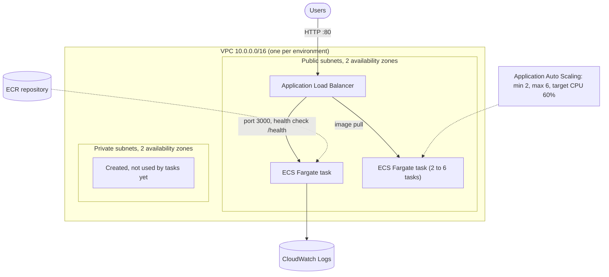
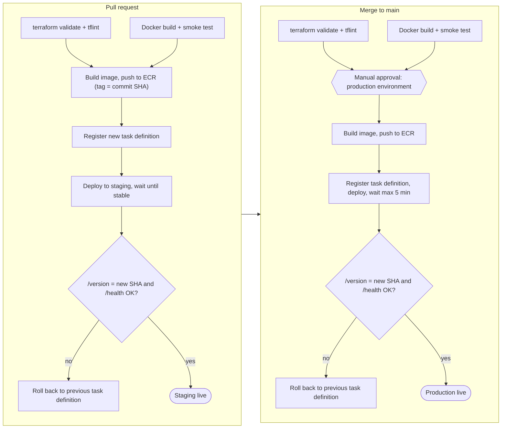

# infra-as-code-pipeline

Zero-touch deployments for a small Node.js app on AWS ECS Fargate.

- All infrastructure is written in Terraform modules (VPC, ALB, ECS Fargate, ECR, IAM, CloudWatch) with remote state and locking.
- A GitHub Actions pipeline takes code from a pull request to production: lint, build, push to ECR, deploy to staging, manual approval, deploy to production.
- If a deployment does not become healthy, the pipeline rolls back to the previous ECS task definition automatically.

Built for DevOps Institute Mumbai, Capstone Project 3 (Terraform, GitHub Actions, AWS ECS).

## Contents

1. [Architecture](#architecture)
2. [Environments](#environments)
3. [Pipeline flow](#pipeline-flow)
4. [Rollback](#rollback)
5. [Repository layout](#repository-layout)
6. [Setup instructions](#setup-instructions)
7. [Runbook](#runbook)
8. [Cost estimate](#cost-estimate)
9. [Security notes](#security-notes)
10. [Limitations and next steps](#limitations-and-next-steps)

## Architecture

Every environment (staging, prod) gets its own copy of this stack, created from the same Terraform code with a different `environment` value.



| Component | Details |
|---|---|
| Networking module | VPC `10.0.0.0/16`, 2 public subnets, 2 private subnets, internet gateway, route tables. No NAT gateway. |
| Security module | ALB security group (HTTP 80 from the internet), ECS security group (port 3000 from the ALB only), ECS task execution IAM role. |
| Compute module | ECR repository (scan on push), ECS cluster, Fargate task definition (0.25 vCPU, 0.5 GB), ECS service (desired 2), ALB, listener, target group, auto-scaling (min 2, max 6, CPU target 60%). |
| Monitoring module | CloudWatch log group `/ecs/infra-as-code-pipeline-<env>`, 7 days retention. |
| Health check | ALB calls `GET /health` every 15 seconds. The app also exposes `GET /version`, which returns the deployed commit SHA and environment. |
| Cost choice | Tasks run in public subnets with a public IP so no NAT gateway is needed. Only the ALB security group can reach them on port 3000. |

## Environments

Same code, different configuration. Each environment is a Terraform workspace plus a variable file.

| Environment | Workspace | Variable file | AWS resource names |
|---|---|---|---|
| dev (optional, local testing) | `dev` | `terraform/envs/dev.tfvars` | `infra-as-code-pipeline-dev-*` |
| staging | `staging` | `terraform/envs/staging.tfvars` | `infra-as-code-pipeline-staging-*` |
| production | `prod` | `terraform/envs/prod.tfvars` | `infra-as-code-pipeline-prod-*` |

Remote state is stored in S3 with DynamoDB locking (`terraform/backend.tf`), and the state bucket and lock table are created by `terraform/bootstrap`.

## Pipeline flow

The whole pipeline lives in `.github/workflows/ci.yml`.



| Job | Runs on | What it does |
|---|---|---|
| `terraform-lint` | pull request, push to main | `terraform init -backend=false`, `terraform validate`, `tflint --recursive` |
| `docker-build-test` | pull request, push to main | Builds the image, starts the container and calls `/health` (a crashing build never reaches AWS) |
| `deploy-staging` | pull request | Builds and pushes the image tagged with the commit SHA, registers a new task definition, updates the ECS service, waits for it to be stable, checks that the new SHA is served and healthy, rolls back on failure |
| `deploy-production` | push to main | Same steps as staging, but the job first waits for a reviewer to approve the `production` environment, and the deployment must become stable within 5 minutes |

Why the verification checks `/version` and not only `/health`: ECS has its own circuit breaker, which can silently revert to the old version. The old version still answers `/health`, so only comparing the served commit SHA proves that the new version is the one running.

## Rollback

Two layers protect a deployment:

1. **ECS deployment circuit breaker** (Terraform, `deployment_circuit_breaker` with `rollback = true`): ECS reverts a deployment whose tasks keep failing.
2. **Pipeline rollback step**: if the new version is not serving healthy traffic, the pipeline re-points the service to the task definition that was running before the deploy and waits for it to be stable.

Because every image is tagged with its commit SHA and every deploy registers a new task definition revision, any previous version can be restored in about a minute (the time ECS needs to start and register tasks).

**Tested on purpose** in [pull request #4](https://github.com/Aditya-7788/infra-as-code-pipeline/pull/4):

1. A commit made `/health` return HTTP 500 only when the `ENVIRONMENT` variable is set (CI does not set it, so the smoke test passed, but ECS does).
2. The staging deploy failed its verification step and the rollback step restored the previous task definition.
3. The break was reverted and the next staging deploy went green.

Manual rollback is described in the [runbook](#runbook).

## Repository layout

```
.
├── .github/workflows/ci.yml        # the whole CI/CD pipeline
├── app/                            # Node.js to-do app
│   ├── server.js                   # HTTP server, /health and /version endpoints
│   ├── public/                     # front end
│   ├── test/server.test.js
│   ├── Dockerfile
│   └── package.json
└── terraform/
    ├── backend.tf                  # S3 remote state + DynamoDB locking
    ├── providers.tf, main.tf, variables.tf, outputs.tf
    ├── bootstrap/                  # creates the state bucket and lock table (run once)
    ├── envs/                       # dev.tfvars, staging.tfvars, prod.tfvars
    └── modules/
        ├── networking/             # VPC, subnets, routes
        ├── security/               # security groups, task execution role
        ├── compute/                # ECR, ECS, ALB, auto-scaling
        └── monitoring/             # CloudWatch log group
```

## Setup instructions

### Prerequisites

- AWS account and AWS CLI configured (`aws sts get-caller-identity` works)
- Terraform 1.5 or newer (or Docker, see the tip below), Docker, Git
- A GitHub repository for this code

Tip: if `terraform.exe` is blocked on your machine (for example by a Windows Application Control policy), run Terraform in Docker. In PowerShell:

```powershell
function tf { docker run --rm -it -v "${PWD}:/workspace" -w /workspace -v "$env:USERPROFILE\.aws:/root/.aws" hashicorp/terraform:latest @args }
```

Then use `tf` instead of `terraform`. In PowerShell, quote arguments that contain a dot: `tf plan "-var-file=envs/staging.tfvars"`.

### 1. Create the remote state backend (once)

```bash
cd terraform/bootstrap
terraform init
terraform apply
```

Check the variables at the top of `bootstrap/main.tf` first (region, bucket name). S3 bucket names are global, so the name must be unique. Make sure `terraform/backend.tf` uses the same bucket and lock table names.

### 2. Create the environments

Always pass the variable file. Without it Terraform asks for `environment` interactively and anything you type becomes the environment name.

```bash
cd terraform
terraform init

# staging
terraform workspace new staging
terraform plan  -var-file=envs/staging.tfvars
terraform apply -var-file=envs/staging.tfvars

# production
terraform workspace new prod
terraform plan  -var-file=envs/prod.tfvars
terraform apply -var-file=envs/prod.tfvars
```

Run `terraform workspace list` before every apply or destroy and check which workspace has the `*`.

### 3. Point the pipeline at your environments

Run `terraform output` in each workspace and copy the values into the `env:` block of the matching job in `.github/workflows/ci.yml`:

| Variable in `ci.yml` | Terraform output |
|---|---|
| `ECR_REPOSITORY` | last part of `ecr_repository_url` |
| `ECS_CLUSTER` | `cluster_name` |
| `ECS_SERVICE` | `service_name` |
| `ALB_URL` | `http://` + `alb_dns_name` |

### 4. Configure GitHub

1. Settings, Secrets and variables, Actions: add `AWS_ACCESS_KEY_ID` and `AWS_SECRET_ACCESS_KEY` of a deployer IAM user. No secrets are stored in the code.
2. Settings, Environments: create `staging` (no rules) and `production`.
3. In `production`, add yourself under Required reviewers. If you are the only person who triggers runs, turn off "Prevent self-review", otherwise the approve button never appears.
4. Give the deployer IAM user this policy (adjust the account ID and region):

```json
{
  "Version": "2012-10-17",
  "Statement": [
    { "Effect": "Allow", "Action": "ecr:GetAuthorizationToken", "Resource": "*" },
    {
      "Effect": "Allow",
      "Action": [
        "ecr:BatchCheckLayerAvailability", "ecr:InitiateLayerUpload", "ecr:UploadLayerPart",
        "ecr:CompleteLayerUpload", "ecr:PutImage", "ecr:BatchGetImage", "ecr:GetDownloadUrlForLayer"
      ],
      "Resource": "arn:aws:ecr:ap-south-1:<ACCOUNT_ID>:repository/infra-as-code-pipeline-*"
    },
    {
      "Effect": "Allow",
      "Action": [
        "ecs:DescribeServices", "ecs:DescribeTaskDefinition",
        "ecs:RegisterTaskDefinition", "ecs:UpdateService"
      ],
      "Resource": "*"
    },
    {
      "Effect": "Allow",
      "Action": "iam:PassRole",
      "Resource": "arn:aws:iam::<ACCOUNT_ID>:role/infra-as-code-pipeline-*-task-execution-role"
    }
  ]
}
```

### 5. Deploy

1. Open a pull request: the pipeline lints, builds and deploys to staging. Check `http://<staging alb>/health` and `/version`.
2. Merge to `main`: the pipeline waits for approval. Open the run in the Actions tab, click Review deployments, tick `production`, and approve.
3. Check `http://<production alb>/version`: it must show the SHA of the merge commit.

### 6. Tear down

Staging and production cost money while they run (see the cost estimate). Destroy them when you are done:

```bash
terraform workspace select staging
terraform destroy -var-file=envs/staging.tfvars
terraform workspace select prod
terraform destroy -var-file=envs/prod.tfvars
```

The ECR repositories are created with `force_delete = true`, so destroy also removes the images.

## Runbook

Replace `<env>` with `staging` or `prod`.

| Symptom | Likely cause | What to do |
|---|---|---|
| ALB returns 502 or 503 | No healthy targets: tasks are starting, crashing, or failing the health check | 1. `aws elbv2 describe-target-health --target-group-arn <arn>` to see target state. 2. `aws ecs describe-services --cluster infra-as-code-pipeline-<env>-cluster --services infra-as-code-pipeline-<env>-service --query "services[0].events[:5].message"`. 3. Read the container logs (next row). |
| Tasks start and stop in a loop, exit code 1 | The app crashes on start | `aws logs tail /ecs/infra-as-code-pipeline-<env> --since 20m`. Reproduce locally with `docker run -p 3000:3000 <image>`. Fix the code and push. (Real example from this project: `SyntaxError: Illegal return statement` caused by endpoints pasted outside the request handler.) |
| `CannotPullContainerError ... not found` | The image tag does not exist in ECR, usually on the very first deploy before the pipeline pushed an image | Run the pipeline so it pushes an image, or push one manually and force a new deployment. |
| Pipeline fails with `AccessDenied` | The deployer IAM user is missing a permission | Compare its policy with the one in [Configure GitHub](#4-configure-github). |
| Production job waits but there is no Approve button | You are not a required reviewer, or "Prevent self-review" is on | Settings, Environments, `production`: add yourself, turn off Prevent self-review, save, reload the run page. |
| Deploy failed and "Roll back" ran | The new version did not serve healthy traffic | Open the failed step in the run log. The log prints the previous task definition ARN. Fix forward and push, the service is already back on the previous version. |
| Rollback step also failed | The previous task definition is itself broken (for example after a very first deploy) | Do a manual rollback to the last good revision (below). |
| Terraform asks for `var.environment` | `-var-file` was not passed | Press Ctrl+C. Do not type `yes`: it becomes the environment name and every resource gets that name. Re-run with `-var-file=envs/<env>.tfvars`. |
| Terraform wants to change the ECS task definition | Drift between the pipeline and Terraform | The service has `ignore_changes = [desired_count, task_definition]`, so the pipeline owns task definitions. If a plan still shows it, check that the lifecycle block is intact. |
| `Error acquiring the state lock` | A previous run was interrupted | Make sure nobody is running an apply, then `terraform force-unlock <LOCK_ID>`. |
| `VpcLimitExceeded` | The default limit of 5 VPCs per region is reached | Destroy an unused environment (for example dev) or request a quota increase. |
| tflint fails in CI | Missing version constraints or untyped variables | Each module has a `versions.tf`. Run tflint locally: `docker run --rm -v "$PWD:/data" -w /data ghcr.io/terraform-linters/tflint --recursive`. |

### Manual rollback

```bash
CLUSTER=infra-as-code-pipeline-prod-cluster
SERVICE=infra-as-code-pipeline-prod-service

# 1. See which revisions exist, newest first
aws ecs list-task-definitions --family-prefix infra-as-code-pipeline-prod --sort DESC --max-items 5

# 2. Point the service at the last good revision
aws ecs update-service --cluster $CLUSTER --service $SERVICE --task-definition <previous-task-definition-arn>

# 3. Wait for it to become stable, then check the version
aws ecs wait services-stable --cluster $CLUSTER --services $SERVICE
curl http://<alb-dns-name>/version
```

## Cost estimate

Estimate for one environment running 24/7 for a month (730 hours) in `ap-south-1` (Mumbai), with 2 tasks of 0.25 vCPU and 0.5 GB, no NAT gateway, low traffic. Prices change, so confirm with the [AWS Pricing Calculator](https://calculator.aws/) before relying on these numbers.

| Item | Basis | Per month (USD) |
|---|---|---|
| Fargate compute | 2 tasks x 0.25 vCPU x $0.04256/hour | about 15.5 |
| Fargate memory | 2 tasks x 0.5 GB x $0.004655/GB-hour | about 3.4 |
| Public IPv4 for tasks | 2 addresses x $0.005/hour | about 7.3 |
| ALB hourly charge | about $0.0225/hour (US East rate used as an approximation) | about 16.4 |
| ALB capacity units | at least 1 LCU x $0.008/hour | about 5.8 |
| Public IPv4 for ALB | 2 addresses (2 AZs) x $0.005/hour | about 7.3 |
| CloudWatch Logs, ECR storage, data transfer | low traffic, 7 day log retention | under 2 |
| **One environment** | | **about 57** |
| **Staging + production** | | **about 115** |

- Shared infrastructure (S3 state bucket, DynamoDB lock table) costs pennies.
- If auto-scaling runs 6 tasks all month, one environment costs about 110, so the two environments could reach about 220. That only happens under sustained load.
- A NAT gateway would add roughly 35 to 40 USD per month per environment, which is why tasks run in public subnets.
- One environment costs about 1.9 USD per day, so destroying both after a demo saves most of the bill.

## Security notes

- No secrets in the repository. AWS credentials live in GitHub Secrets.
- The ECS tasks accept traffic on port 3000 only from the ALB security group.
- The deployer IAM user is limited to ECR push, ECS deploy, and PassRole on the task execution roles.
- ECR scans images on push.
- Production deployments need a human approval.
- Terraform state is stored remotely with locking, never in git (`.gitignore` excludes state files and plan output).

## Limitations and next steps

- The load balancer serves HTTP only. A real deployment needs a domain, an ACM certificate and an HTTPS listener.
- The pipeline authenticates with long-lived IAM user keys. GitHub OIDC with a role would remove stored keys.
- Tasks run in public subnets to avoid NAT costs. The private subnets are ready for a private setup with VPC endpoints.
- Stretch goals not done yet: Trivy and tfsec scans, Terraform plan as a pull request comment, Slack notifications, infracost, blue-green deployment with CodeDeploy.
